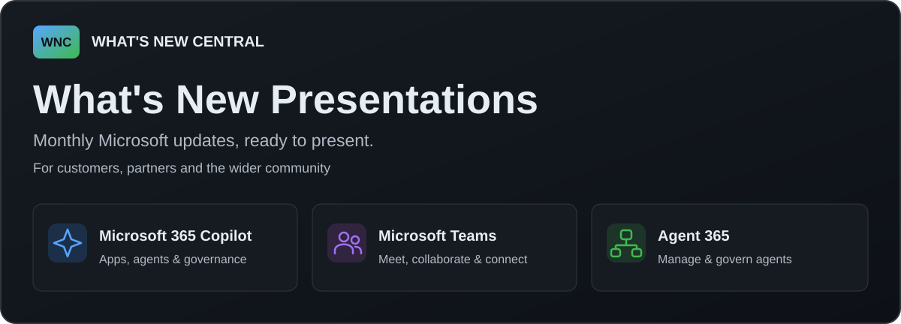

# What's New Presentations

Monthly Microsoft 365 Copilot, Microsoft Teams and Agent 365 presentations,
created and curated by [Martin Boam](https://github.com/martinboam) for community
learning, education and knowledge sharing. For customers, partners and the
wider community.

**Quick links:** [Full library](https://whatsnewcentral.com/downloads.html) |
[GitHub downloads](https://github.com/martinboam/whats-new-presentations/releases) |
[Get release alerts](#get-notified)

## One library, two complementary services

- **[What's New Central](https://whatsnewcentral.com/downloads.html)** is the
  main catalogue: browse products and editions, see covers, read summaries and
  explore related resources.
- **This repository's [Releases](https://github.com/martinboam/whats-new-presentations/releases)**
  provide published presentation files and GitHub release notifications.
  Each release links back to its edition on What's New Central.

GitHub distribution is being introduced gradually. Editions not yet available
here remain downloadable from What's New Central. A release subscription covers
new GitHub publications, not every edition already available on the website.

## Latest editions published on GitHub

These links are maintained automatically from published releases, by edition
date rather than upload date. This is a shortcut, not a second catalogue.
For the full library and editions not yet migrated, use What's New Central.

<!-- latest-presentations:start -->
| Product | Latest GitHub edition | Full library |
|---|---|---|
| Microsoft 365 Copilot | [Microsoft 365 Copilot - October 2026](https://github.com/martinboam/whats-new-presentations/releases/tag/Copilot-2026-10) | [Browse editions](https://whatsnewcentral.com/downloads.html?category=copilot) |
| Microsoft Teams | [Microsoft Teams - August and September 2026](https://github.com/martinboam/whats-new-presentations/releases/tag/teams-2026-09) | [Browse editions](https://whatsnewcentral.com/downloads.html?category=teams) |
| Agent 365 | [Microsoft Agent 365 - September 2026](https://github.com/martinboam/whats-new-presentations/releases/tag/agent365-2026-09) | [Browse editions](https://whatsnewcentral.com/downloads.html?category=agent365) |
<!-- latest-presentations:end -->

## Download a presentation

Open an edition above or visit [Releases](https://github.com/martinboam/whats-new-presentations/releases).
Use its download link, or expand **Assets** and choose the PowerPoint or PDF.
A GitHub account is not required to download public release attachments.
GitHub's automatically generated source-code ZIP/TAR files are not presentations.

The website's download button points directly to the GitHub attachment for
migrated editions. You do not need to download the same presentation twice.

## Get notified

1. Sign in to GitHub and select **Watch** at the top of this repository.
2. Choose **Custom**, select **Releases**, then **Apply**.
3. Check your [GitHub notification settings](https://github.com/settings/notifications)
   if you want email delivery.

Subscriptions cover **all products** in this repository. Starring the repository
does not subscribe you to notifications. GitHub does not provide a per-product
release subscription within this repository.

Prefer a feed reader? Subscribe to the
[GitHub releases Atom feed](https://github.com/martinboam/whats-new-presentations/releases.atom);
no GitHub account is required.

For the distinction between website updates and GitHub release alerts, see
[presentation update options on What's New Central](https://whatsnewcentral.com/downloads.html#presentation-updates).

## Publisher and availability

Martin Boam is the sole creator and owner of the original presentation content
and works at Microsoft. These presentations are shared with the community as
part of What's New Central; publication here does not imply official Microsoft
endorsement.

Presentations reflect information available when prepared; features,
availability, licensing and rollout dates can change. Check the presentation's
linked Microsoft sources for current details.

## Sources

Presentations bring together information from Microsoft blog posts and product
announcements, the public
[Microsoft 365 roadmap](https://www.microsoft.com/en-us/microsoft-365/roadmap),
and Microsoft 365 Message Center announcements.

Source access and terms vary, particularly for Message Center: its announcements
are not assumed to be public. Tenant-specific, confidential or restricted
information must not be shared here. Public availability of a source does not
itself grant permission to reuse its text, images or other protected material.

## Licensing and reuse

**Martin Boam's original presentation and companion content distributed through
this repository and its GitHub Releases is licensed under
[Creative Commons Attribution 4.0 International (CC BY 4.0)](https://creativecommons.org/licenses/by/4.0/).**
Copyright (c) 2026 Martin Boam. See [LICENSE.txt](LICENSE.txt) for the scope and
full legal terms.

You may present, copy, adapt and redistribute the licensed content, including
for commercial training and workshops. Give appropriate credit, link to the
licence and identify any changes. Learning and education are the purpose of
this resource, not an additional restriction on the licence.

Microsoft and third-party materials, including quoted source text, screenshots,
logos and trademarks, are excluded and remain subject to their respective
rights, notices and permissions. This content licence does not license the
repository's workflows or automation code, and reuse must not imply endorsement
by Martin Boam or Microsoft.

Suggested attribution:

> "[Presentation title]" by Martin Boam / What's New Central
> (https://whatsnewcentral.com), licensed content under CC BY 4.0
> (https://creativecommons.org/licenses/by/4.0/). Adapted by [name] with [changes],
> if modified.

## Feedback

[Open an issue](https://github.com/martinboam/whats-new-presentations/issues)
for a broken download, presentation error or suggestion. Include the edition
and slide number where relevant. Do not include confidential information,
customer data or credentials in public issues.

## Automation maintenance

Publishing automation uses only SHA-pinned `actions/checkout` and
`actions/setup-node`. Dependabot proposes monthly Actions updates and security
fixes when available; maintainers review and merge these pull requests manually,
preserving full-SHA pins.
The main branch blocks deletion and force pushes while allowing normal commits
and the automated latest-edition README refresh.
